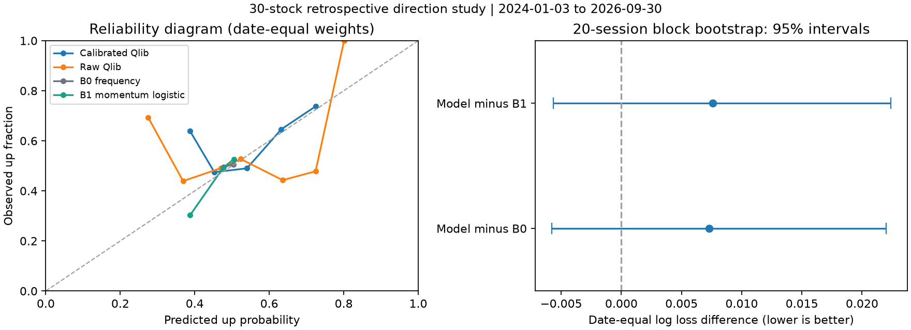

# 10期方向概率研究：工程链路完成，整体无增益

2026-11-17，Asia/Shanghai。新实验基线 main `62a1c13`；协议/参数先冻结于 `7dc5c02`，完整滚动训练与复现代码 `f2fabe9`，之后补充了严格二分类符号审计及推理身份。所有后续修正均未改训练窗口、参数、校准、评价区间、阈值或月更安排。原排名实验及其阴性结果原样保留。

**采用判断：DO_NOT_ADOPT_NO_INCREMENTAL_GAIN。** 校准后的方向模型没有稳定胜过历史频率或一因子逻辑回归。工程训练、预测、概率评价和预测留存可以独立验收；本结果不支持买卖点或交易采用。没有因阴性结果搜索新参数、阈值或成功年份。

结构化脱敏汇总见 [summary.json](research/direction-forecast-20261117-summary.json)，冻结目标与实施计划见[现行协议](RESEARCH-PROTOCOL.md#方向预测实验-wp-aql-direction-forecast-01)，复现命令见[运行手册](RUN-TUSHARE-QLIB.md#方向概率研究wp-aql-direction-forecast-01)。原始/逐股明细、模型和完整依赖/源码哈希留私有外置盘，未公开付费行情或凭据。

## 冻结问题与实际执行

唯一目标：使用T及以前行情，预测 `r=adjusted_close(T+11)/adjusted_close(T+1)-1` 是否严格大于0。零收益属于“未上涨”，不称为下跌；未成熟/缺端点标签保持缺失。目标是T+1收盘到T+11收盘10期调整后价格方向，不是当前起算收益或可成交净收益。

原30股固定样本；官方Qlib 0.9.7的158个表达式逐项审计，最大回溯60交易日、无未来依赖。要求原始OHLC/VWAP/volume在当前及前60个交易日齐备；先在完整provider日历计算特征、动量和收益，保留缺失，再做质量筛选。没有填价、压缩日历或扩大容差。部分表达式在完整价格窗口仍可有NaN，交给LightGBM原生缺失处理，不估计跨时期填充值。

Alpha158 → 明确的BinaryLabel/DropnaLabel学习处理 → 官方LGBModel(binary)。推理处理器为空，分类标签不做截面归一化，标签组不会进入158列特征。模型以原生binary概率输出，独立126日时序段上做Platt校准；原始概率另列。B0是同一756日训练段的Beta(1,1)平滑上涨比例；B1是训练段20日动量的标准化一因子逻辑回归。

每月首个交易日前更新：756日训练、126日早停、126日校准；分段间11个信号交易日隔离，并用实际T+11标签结束日检查。训练标签结束日早于早停起日，早停标签结束日早于校准起日，校准标签结束日不晚于更新前一交易日。完整月更分段和截止都在每月model-record.json中。没有随机交叉验证。

评价区间固定为2024-01-03至2026-09-30，33次月更、665个预测日期；此历史此前已被查看，明确为回顾性滚动验证。学习率.05、深度6、31叶、240轮上限、早停30、seed23、4线程，确定性设置；阈值.5。未以本轮结果重新选择配置。

## 真实概率评价

共同有效范围逐日截面平均，再日期等权。混淆矩阵和平衡准确率按证券日期统计；校准曲线的每条记录使用日期权重，10个预先固定等宽箱。原始模型是辅助诊断，主比较一直是校准模型对B0/B1。

| 概率 | 日期数 | 共同证券日期对 | 日期等权log loss | Brier | 平衡准确率 |
| --- | ---: | ---: | ---: | ---: | ---: |
| Qlib校准概率（主） | 665 | 19,869 | 0.701451 | 0.254073 | 0.500257 |
| Qlib原始binary概率 | 665 | 19,869 | 0.695860 | 0.251286 | 0.510166 |
| B0历史上涨比例 | 665 | 19,869 | 0.694153 | 0.250500 | 0.502059 |
| B1动量逻辑概率 | 665 | 19,869 | 0.693849 | 0.250348 | 0.506858 |

| 主配对差值：模型减基线，低为好 | 点估计 | 预先固定20交易日移动时间块95%区间 |
| --- | ---: | ---: |
| 校准模型 − B0 | +0.007298 | [-0.005763, +0.022011] |
| 校准模型 − B1 | +0.007602 | [-0.005637, +0.022371] |

块bootstrap固定2000次、seed23，抽完整日期保留截面关联，不把同日30股或重叠10期标签当独立样本。两个均值都更差、区间都跨零；没有增益证据，也不能据此断言精确的负效应已经显著。校准后log loss/Brier比原始模型更差；“校准器已独立时序拟合”不等于概率可靠性通过。平衡准确率略高于50%也不能单独验收。

稀疏概率箱可能只有很少样本，曲线不能视为稳定校准证明；每箱行数、日期权重及原始/校准/基线曲线数据保留在summary。

| 时间段 | 有效日期 | 配对数 | 校准模型log loss | B0 | B1 | 模型−B0 | 模型−B1 |
| --- | ---: | ---: | ---: | ---: | ---: | ---: | ---: |
| 2024 | 241 | 7,230 | 0.715461 | 0.692454 | 0.692420 | +0.023007 | +0.023040 |
| 2025 | 243 | 7,277 | 0.694864 | 0.701828 | 0.701833 | -0.006963 | -0.006969 |
| 2026至9月 | 181 | 5,362 | 0.691639 | 0.686110 | 0.685030 | +0.005529 | +0.006608 |

不能挑2025或原始模型个别年份宣布成功。逐证券所有结果留在完整私有study-report中，不挑胜者。主模型混淆矩阵（行实际0/1，列预测0/1）为 `[[5781,4241],[5675,4172]]`；B0为`[[9074,948],[8875,972]]`，B1为`[[8988,1034],[8696,1151]]`。

## 覆盖、缺失与常数截面

- 计划分母665×30=19,950；四个概率入口各自输出19,880（99.649%），自身可评价范围各19,869；共同评价也为19,869。没有以交集隐藏额外模型失败。
- 原始成熟标签19,930；缺未来端点20对，保持缺失而非负例。70对因完整60日回溯质量条件不满足而无概率输出；两类缺失重叠9对，总共排除81对。缺行情原因仍为UNCLASSIFIED，不伪称已核实停牌。
- 配对正例9,847（49.5596%），未上涨10,022（50.4404%）；零收益116对，包含在未上涨中并单列。
- 保留13个观测标签全上涨日期及1个全未上涨日期，没有复用RankIC的常数截面排除。单类子段平衡准确率返回不可计算，log loss/Brier继续计算。
- 2024输出7,230/7,230；2025输出7,288/7,290、配对7,277；2026输出5,362/5,430、配对5,362。逐年排除/各自输出计数保留在summary。

## 血缘、复现与失败范围

历史链完全复用原真实Tushare完整capture、DuckDB → Parquet → 官方Binary，不重新采集或覆盖旧结果。历史manifest `06b067a408e7c713d34b5625afba615a01cb939a4bb0dd525e332a77abd142d3`；全部Binary哈希训练前复验，完整日历1,897日；原生日收益/20日动量与完整日历shift对账。158个窗口回溯审计没有将20日动量等同全特征预热。

初次预检发现完整日历网格中有1个原生instrument生效前日期：SH600030从2019-01-10生效，2019-01-09有未来端点但不属于原生返回键。审计改为在原生实际键上对账，完整网格仍保留为覆盖分母；没有填价、放宽容差或改测试样本。新增严格0/1符号对账，防止数值容差掩盖分类边界差异。

首次正式运行`real-01/study`与`real-01/study-final`的19,950行观察表完全一致，34个月模型（33个评价月及10月独立模型）文本逐字节一致；首评价月在每次研究内还独立重复训练，模型字节/校准段概率一致。最新入口独立加载可信model-record SHA、模型文本SHA、binary objective及158列定义，绝不反序列化陌生pickle。首次与复验的最新概率也一致。

本地58项测试PASS；官方转换/Alpha158/原生binary完整合成链PASS并明确标记SYNTHETIC_ENGINEERING_ONLY，合成指标没有用于上表。测试覆盖零/正/负/缺失标签、未来标签缺失仍保留推理特征、交易日标签结束隔离、全单类日期、日期等权/时间块复现、各自/共同覆盖、追加复盘不改原预测、模型记录和模型字节篡改拒绝。公开CI以PR最终head为准。

真实研究私有根目录：`/Volumes/DevSSD/Development/Workspace/task-data/WP-AQL-DIRECTION-FORECAST-01/20261117`。`real-01/study-final`保存完整历史评价；`real-01/reproduction-verification.json`保存真实复现核对。`synthetic-native-final`为独立合成工程证据。训练依赖：Qlib0.9.7、LightGBM4.7.0、MLflow2.22.5、DuckDB1.5.6、PyArrow19.0.1、pandas2.3.3、NumPy2.5.5、scikit-learn1.9.1。

## 最新真实时点推理与复盘

最终样例使用独立新批次`real-02`，截至**2026-11-17**（当日交易已结束且全30股行情/复权/回溯齐备），不是历史测试末日：

| 项目 | 实际记录 |
| --- | --- |
| 生成时刻 | 2026-11-17 16:42:19.399673 +08:00 |
| 预测区间 | 2026-11-18收盘 → 2026-12-02收盘，10期调整后价格方向 |
| 实际源采集 | 16:38:44开始，16:41:29完成；capture `1812aac60b3b44e991333087d63cef88` |
| 数据规模/审计 | 57,200条真实日线；64次源响应；SSE/SZSE日历一致、内部量价/复权检查0异常 |
| 最新snapshot | `d2929a7e1b61bff7d475176fd3c3e6b4dbf872e835e26e88172363cf5c407568` |
| 模型SHA256 | `3dc7c474c26db85384929d6c6ea607c89d64beb07bcf7b428b6e4f701b67cf73` |
| 可信model-record SHA | `7627ae790ccd49a5a2ec326b3f3de6f705cf6c8ca6a0079ff7e49c1a358073dd` |
| 原预测SHA256 | `6318702e2e53049faf8df557e81ac82bfa19d8d757ef5cf6af6d3556c6b27e33` |
| 工程/校准状态 | CURRENT_COMPLETED_SESSION_RESEARCH_ONLY；30/30原始及校准概率；独立Platt已拟合但可靠性未认证 |
| 生成资格 | ISSUED_BEFORE_TARGET_ENTRY_CLOSE；实际自然前瞻性能PENDING_NOT_ESTABLISHED |
| 首次复盘 | PENDING_FUTURE_LABELS，y保持null |

月更模型anchor为2026-11-02，信息成熟截止2026-10-30；train信号日2022-07-14—2025-08-22、早停2025-09-09—2026-03-23、校准2026-04-09—2026-10-15。三段标签实际结束日分别为2025-09-08、2026-04-08、2026-10-30。最新入口只加载该模型文本与158列特征，不读取标签、不调用fit；两次推理完全一致。最新capture训练出的模型字节也与首次独立批次的月更模型一致。

初版18:00保守门槛在16:34仅确认11月16日快照。它没有核查当日源是否已齐备，也已晚于该样例T+1目标入场收盘；其原预测/复盘和全部产物保留在real-01，不计入自然前瞻。随后按实际任务语义收紧最新资格为“15:00收盘后实际抓取并验证全30股”，新capture核查到11月17日。此项运行边界修正没有改变历史滚动实验的任何模型/评价选择。

逐股样例位于私有`real-02/prediction.json`；模型和处理器定义位于`real-02/latest-training/model/`，数据/全字段官方投影在`real-02/parquet/`和`binary/`；`initial-review.json`绑定原预测SHA且保留未成熟null。`review-direction`在后续新快照中追加成熟标签、原始概率及log loss/Brier，拒绝覆盖任何原预测/复盘文件。未来若有修订，新的review快照身份单独记录；实际自然前瞻表现需等2026-12-02收盘后源齐备再判断，本任务没有自动部署定时任务。

## 验收分开判断

| 范围 | 结论 | 限制 |
| --- | --- | --- |
| 独立应用/原生Qlib分类链 | PASS，可合并工程实现 | 本地58项、真实滚动/独立推理、合成CI链；PR状态以最终head检查为准 |
| 真实滚动对照 | COMPLETE，整体无增益 | 固定当代30股、回顾性、重叠10期，不能宣称真正未见OOS |
| 最新日推理工程 | PASS，2026-11-17，30/30 | 概率明确RESEARCH_ONLY，无可靠判断或采用价值承诺 |
| 预测留存/成熟后复盘入口 | PASS工程；当前标签PENDING | 成熟分支单测通过；本次新预测真实成熟复盘尚未到期 |
| 模型采用 | DO_NOT_ADOPT | 全段均值未超基线、区间跨零、年度不稳定，校准未获可靠性资格 |
| PIT/数据历史真实性 | NOT_ESTABLISHED | 证券池选择/幸存者偏差，历史修订/发布与可用时钟、缺失原因、独立公司行为证据不齐 |
| 经济收益/实盘/买卖点 | NOT_RUN / NOT_AUTHORIZED | 未模拟成交、T+1/限价/整手/费用/冲击/订单；没有交易建议 |

没有重写TSP页面、重启TSP/MRA、改写真实交易环境、购买数据或追加模型搜索。旧排名结论不因新实验工程完成而升级。允许停止这个方向假设；是否继续研究需要新的明确授权与预先声明。
